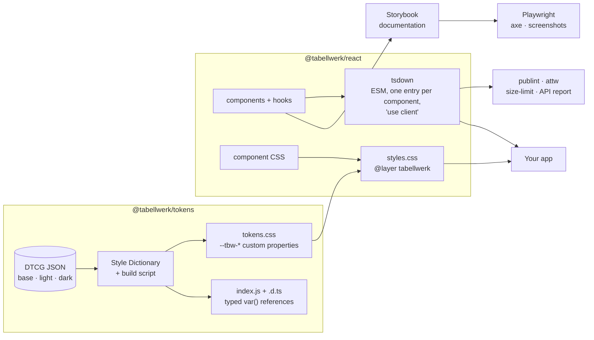

# Tabellwerk

**Accessible React components centred on a fast data grid.** A WAI-ARIA grid for 100,000 rows with
sorting, filtering and column resizing by keyboard and pointer, plus the two widgets most libraries
get wrong: a combobox with autocomplete and a date picker. Framework-neutral design tokens,
light/dark/forced-colours themes, and every claim backed by a test.

> **Status: under construction.** This is Phase 0 (foundation): the token package, two accessibility
> utilities and the complete test and release tooling. The grid, combobox and date picker follow in
> the phases of the [roadmap](docs/ROADMAP.md). Nothing is published to npm yet, and the
> documentation site goes live with the first grid release.

## Packages

| Package              | What it contains                                                                                            |
| -------------------- | ----------------------------------------------------------------------------------------------------------- |
| `@tabellwerk/tokens` | Design tokens as CSS custom properties (light, dark, forced colours) and typed `var()` references; no React |
| `@tabellwerk/react`  | Components and hooks; one entry point per component; one stylesheet that includes the tokens                |

Available today: `VisuallyHidden` (text for assistive technology only) and `LiveAnnouncer` with
`useAnnouncer()` (polite and assertive screen reader announcements).

## Planned features

- **Data grid** following the [WAI-ARIA grid pattern](https://www.w3.org/WAI/ARIA/apg/patterns/grid/):
  100,000 rows with virtualisation, one tab stop and arrow-key navigation, sorting, per-column
  filters, column resizing by keyboard, pointer and touch, performance budgets checked in CI
- **Combobox** with list and inline autocomplete, async options and correct IME handling
- **Date picker** dialog with a keyboard-operable calendar grid and locale-aware week start
- Controlled and uncontrolled state everywhere; hooks for custom markup, components for the rest
- Server rendering without hydration warnings

## Tech stack

| Area           | Choice                                                                     |
| -------------- | -------------------------------------------------------------------------- |
| Monorepo       | pnpm workspaces, Turborepo                                                 |
| Library        | React 19, TypeScript 6 (strict, `isolatedDeclarations`), tsdown (ESM only) |
| Styling        | Plain CSS on custom properties, in the cascade layer `tabellwerk`          |
| Tokens         | DTCG JSON, Style Dictionary                                                |
| Documentation  | Storybook 10                                                               |
| Testing        | Vitest (Node and browser mode), Playwright, axe-core                       |
| Package checks | publint, Are the Types Wrong, size-limit, API Extractor                    |
| Releases       | Changesets                                                                 |

## Architecture



The reasoning behind these choices is recorded in [Architecture Decision Records](docs/adr):
[package layout and toolchain](docs/adr/0001-monorepo-and-package-layout.md),
[tokens and cascade layers](docs/adr/0002-styling-with-tokens-and-cascade-layers.md),
[testing strategy](docs/adr/0003-testing-strategy.md).

## Project structure

```
packages/
  tokens/     @tabellwerk/tokens: DTCG sources, build script, contrast tests
  react/      @tabellwerk/react: components, stories, tests, Storybook config
    e2e/      Playwright: axe and visual regression on the Storybook build
    etc/      API report (public API, reviewed in every pull request)
scripts/      static file server for tests, visual tests in Docker
docs/
  adr/        Architecture Decision Records
  ROADMAP.md  phases and their "done when" criteria
```

## Getting started

Requirements: Node.js 24+, pnpm, and Docker for updating visual baselines.

```bash
pnpm install
pnpm --filter @tabellwerk/react exec playwright install chromium   # once
pnpm build
pnpm storybook        # http://localhost:6006
```

## Scripts

| Command              | What it does                                                                        |
| -------------------- | ----------------------------------------------------------------------------------- |
| `pnpm check`         | Lint, typecheck, unit and browser tests, build, package checks (everything CI runs) |
| `pnpm storybook`     | Storybook in development mode                                                       |
| `pnpm build:docs`    | Static Storybook build in `packages/react/storybook-static`                         |
| `pnpm e2e`           | axe on every story in light, dark and forced colours (needs `build:docs`)           |
| `pnpm visual:update` | Record visual baselines in the Playwright Docker image                              |
| `pnpm changeset`     | Describe a change for the changelog                                                 |
| `pnpm format`        | Format the codebase with Prettier                                                   |

## Testing

Tests run where the code runs ([ADR 3](docs/adr/0003-testing-strategy.md)):

| Layer             | Tool                                          | What it covers                                                                |
| ----------------- | --------------------------------------------- | ----------------------------------------------------------------------------- |
| Tokens            | Vitest                                        | WCAG contrast of every colour pair in light and dark, build output            |
| Server rendering  | Vitest in Node                                | Components render without a DOM; live regions exist before the first message  |
| Keyboard, pointer | Vitest browser mode (Chromium via Playwright) | Real key events through the browser's input pipeline                          |
| Stories           | Storybook Vitest addon                        | Every story renders, its play function passes, axe finds no violation         |
| Accessibility     | Playwright + axe-core                         | WCAG 2.1 A/AA on every story in light, dark and forced-colours mode           |
| Visual regression | Playwright in Docker                          | Screenshot of every story in light and dark, compared pixel by pixel          |
| Package           | publint, attw, size-limit, API Extractor      | Exports, type resolution, size per entry point, unintended public API changes |

## What was hard

Things that took longer than expected so far, and what they changed.

- **Two axe runs in one page.** The accessibility tests failed about once in fifty runs with "Axe is
  already running": Storybook's a11y addon starts its own axe pass inside the story frame, and the
  Playwright test started a second one at the same moment. The tests now open stories with the
  addon in manual mode and wait for the story's play function to finish, which also made the
  screenshots deterministic. 140 repeated runs passed afterwards.
- **Screenshots that depend on the operating system.** Font rendering on Windows differs from the
  Linux CI runners, so baselines recorded on the development machine would fail in CI. Baselines are
  recorded and compared only in the Playwright Docker image; the local script copies the repository
  into the container without `node_modules`, because the Windows native binaries do not run there.

## License

[MIT](LICENSE)
