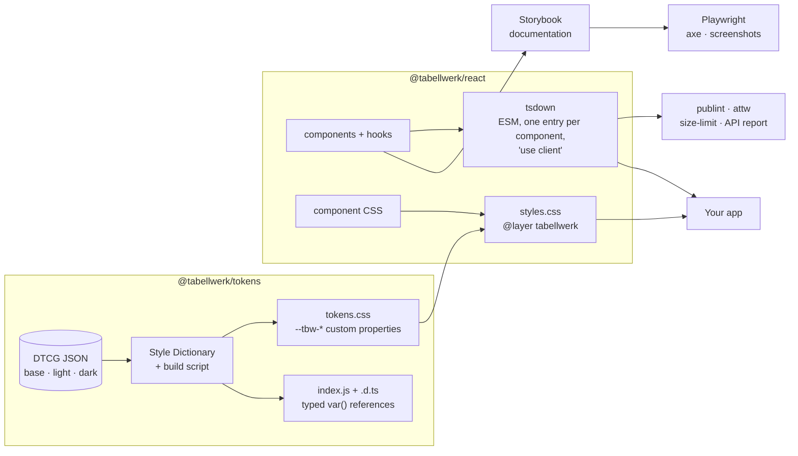
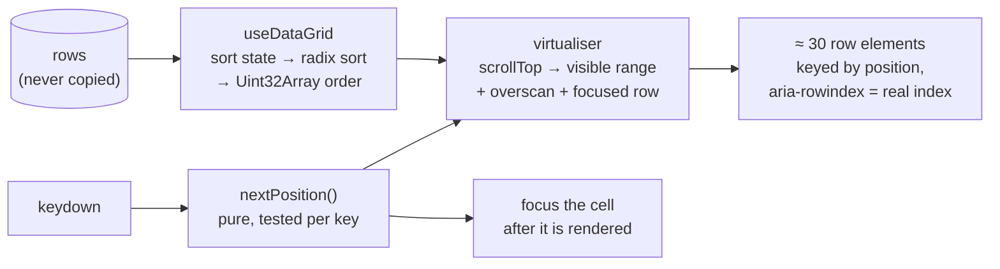

# Tabellwerk

**Accessible React components centred on a fast data grid.** A WAI-ARIA grid for 100,000 rows with
sorting, filtering and column resizing by keyboard and pointer, plus the two widgets most libraries
get wrong: a combobox with autocomplete and a date picker. Framework-neutral design tokens,
light/dark/forced-colours themes, and every claim backed by a test.

**Documentation:** [tabellwerk.vercel.app](https://tabellwerk.vercel.app) (Storybook: component docs,
keyboard tables, all stories in light and dark; try the
[100,000-row grid](https://tabellwerk.vercel.app/?path=/story/components-datagrid--hundred-thousand-rows))

> **Status: under construction.** The data grid renders, navigates, sorts, filters and resizes
> 100,000 rows (Phases 1 and 2). The combobox and the date picker follow in the phases of the
> [roadmap](docs/ROADMAP.md). Nothing is published to npm yet.

## Packages

| Package              | What it contains                                                                                            |
| -------------------- | ----------------------------------------------------------------------------------------------------------- |
| `@tabellwerk/tokens` | Design tokens as CSS custom properties (light, dark, forced colours) and typed `var()` references; no React |
| `@tabellwerk/react`  | Components and hooks; one entry point per component; one stylesheet that includes the tokens                |

## Features

Available today:

- **`DataGrid`** following the [WAI-ARIA grid pattern](https://www.w3.org/WAI/ARIA/apg/patterns/grid/):
  - 100,000 rows with its own virtualiser; only the rows in view are in the DOM, every row keeps
    its real `aria-rowindex`
  - one tab stop; arrow keys, Home/End, Ctrl+Home/End, PageUp/PageDown; Enter or F2 into links and
    buttons inside cells, Escape back; the focused row stays mounted when scrolled away
  - stable single and multi-column sorting by click, Enter or Space, announced to screen readers;
    radix sort over an index permutation, `rows` is never copied
  - per-column filters (text, number range, values, date range) in a header dialog, applied while
    typing; the number of matching rows is announced
  - column resizing by dragging the header edge (mouse, pen, touch) or with the keyboard, and fit
    to content; a width change renders no row
  - controlled or uncontrolled sort, filter and width state, translatable texts, `useDataGrid()`
    for custom markup
- **`LiveAnnouncer`** with `useAnnouncer()`: polite and assertive screen reader announcements
- **`VisuallyHidden`**: text for assistive technology only

```tsx
import { DataGrid, type ColumnDef } from "@tabellwerk/react";
import "@tabellwerk/react/styles.css";

const columns: ColumnDef<Price>[] = [
  { id: "time", header: "Time", filter: "date" },
  { id: "price", header: "Price €/MWh", align: "end", filter: "number" },
];

<DataGrid aria-label="Day-ahead prices" rows={rows} columns={columns} style={{ height: 480 }} />;
```

Planned:

- **Combobox** with list and inline autocomplete, async options and correct IME handling
- **Date picker** dialog with a keyboard-operable calendar grid and locale-aware week start
- Controlled and uncontrolled state everywhere; hooks for custom markup, components for the rest
- Server rendering without hydration warnings

## Tech stack

| Area           | Choice                                                                     |
| -------------- | -------------------------------------------------------------------------- |
| Monorepo       | pnpm workspaces, Turborepo                                                 |
| Library        | React 19, TypeScript 6 (strict, `isolatedDeclarations`), tsdown (ESM only) |
| Styling        | Plain CSS on custom properties, in the cascade layer `tabellwerk`          |
| Tokens         | DTCG JSON, Style Dictionary                                                |
| Documentation  | Storybook 10                                                               |
| Testing        | Vitest (Node and browser mode), Playwright, axe-core                       |
| Package checks | publint, Are the Types Wrong, size-limit, API Extractor                    |
| Releases       | Changesets                                                                 |

## Architecture



Inside the grid, data and rendering are separate:



The reasoning behind these choices is recorded in [Architecture Decision Records](docs/adr):
[package layout and toolchain](docs/adr/0001-monorepo-and-package-layout.md),
[tokens and cascade layers](docs/adr/0002-styling-with-tokens-and-cascade-layers.md),
[testing strategy](docs/adr/0003-testing-strategy.md),
[own virtualiser](docs/adr/0004-own-virtualiser.md),
[sorting with radix sort](docs/adr/0005-sorting-with-rank-permutations.md),
[focus and keyboard model](docs/adr/0006-grid-focus-and-keyboard-model.md),
[header controls, filtering and resizing](docs/adr/0007-header-controls-filtering-and-resizing.md).

## Performance

Measured on the production Storybook build with 100,000 synthetic rows × 8 columns, Chromium
158 (headless), CPU throttled 4×, median of 5 runs, on 2026-11-18: locally on an Intel Core
i5-12400F and in CI on a GitHub-hosted `ubuntu-latest` runner (run on PR 6)
([method](docs/adr/0004-own-virtualiser.md#measurements)):

| Interaction                                                 |   Local |      CI | Budget in CI |
| ----------------------------------------------------------- | ------: | ------: | -----------: |
| Mount the grid (click → next paint)                         |  128 ms |   80 ms |       200 ms |
| Sort by a number column                                     |   72 ms |   80 ms |       200 ms |
| Sort by a text column                                       |   64 ms |   64 ms |       200 ms |
| Keyboard step (ArrowDown, PageDown)                         |   32 ms |   32 ms |       100 ms |
| Key press in a text filter (until the character is painted) |   24 ms |   16 ms |       100 ms |
| Key press in a text filter (until the filtered rows show)   |   74 ms |   68 ms |       200 ms |
| Long frames (> 50 ms) while jumping through 10,000 rows     |       2 |       0 |           20 |
| Worst frame while dragging a column edge 200 px             | < 50 ms | < 50 ms |       100 ms |

GitHub-hosted runners vary from run to run: on PR 4 the same runner type needed 112 ms to mount
the grid, on PR 6 80 ms. The budgets are set so that both pass with room to spare.

Interaction times come from the Event Timing API, the data INP is computed from; frames come from
the Long Animation Frames API, which reports only frames over 50 ms. CI runs the same measurement
on every pull request and fails when a median exceeds its budget. Bundle size of the grid: 7.3 kB
(minified and brotli-compressed, checked by size-limit).

## Project structure

```
packages/
  tokens/     @tabellwerk/tokens: DTCG sources, build script, contrast tests
  react/      @tabellwerk/react: components, stories, tests, Storybook config
    e2e/      Playwright: axe and visual regression on the Storybook build
    etc/      API report (public API, reviewed in every pull request)
scripts/      static file server for tests, visual tests in Docker
docs/
  adr/        Architecture Decision Records
  ROADMAP.md  phases and their "done when" criteria
```

## Getting started

Requirements: Node.js 24+, pnpm, and Docker for updating visual baselines.

```bash
pnpm install
pnpm --filter @tabellwerk/react exec playwright install chromium   # once
pnpm build
pnpm storybook        # http://localhost:6006
```

## Scripts

| Command              | What it does                                                                        |
| -------------------- | ----------------------------------------------------------------------------------- |
| `pnpm check`         | Lint, typecheck, unit and browser tests, build, package checks (everything CI runs) |
| `pnpm storybook`     | Storybook in development mode                                                       |
| `pnpm build:docs`    | Static Storybook build in `packages/react/storybook-static`                         |
| `pnpm e2e`           | axe on every story in light, dark and forced colours (needs `build:docs`)           |
| `pnpm visual:update` | Record visual baselines in the Playwright Docker image                              |
| `pnpm perf`          | Performance measurements and budgets (needs `build:docs`)                           |
| `pnpm changeset`     | Describe a change for the changelog                                                 |
| `pnpm format`        | Format the codebase with Prettier                                                   |

## Deployment

The documentation site is the static Storybook build on Vercel (project `tabellwerk`; build
command `pnpm build:docs`, output `packages/react/storybook-static`). Every push to `main` deploys
to [tabellwerk.vercel.app](https://tabellwerk.vercel.app); pull requests get preview deployments.
Nothing is published to npm yet.

## Testing

Tests run where the code runs ([ADR 3](docs/adr/0003-testing-strategy.md)):

| Layer             | Tool                                            | What it covers                                                                |
| ----------------- | ----------------------------------------------- | ----------------------------------------------------------------------------- |
| Tokens            | Vitest                                          | WCAG contrast of every colour pair in light and dark, build output            |
| Server rendering  | Vitest in Node                                  | Components render without a DOM; live regions exist before the first message  |
| Keyboard, pointer | Vitest browser mode (Chromium via Playwright)   | Real key events through the browser's input pipeline                          |
| Stories           | Storybook Vitest addon                          | Every story renders, its play function passes, axe finds no violation         |
| Accessibility     | Playwright + axe-core                           | WCAG 2.1 A/AA on every story in light, dark and forced-colours mode           |
| Visual regression | Playwright in Docker                            | Screenshot of every story in light and dark, compared pixel by pixel          |
| Package           | publint, attw, size-limit, API Extractor        | Exports, type resolution, size per entry point, unintended public API changes |
| Performance       | Playwright, Event Timing, Long Animation Frames | Interaction and scroll budgets on 100,000 rows; render counts per key press   |

## What was hard

Things that took longer than expected so far, and what they changed.

- **Two axe runs in one page.** The accessibility tests failed about once in fifty runs with "Axe is
  already running": Storybook's a11y addon starts its own axe pass inside the story frame, and the
  Playwright test started a second one at the same moment. The tests now open stories with the
  addon in manual mode and wait for the story's play function to finish, which also made the
  screenshots deterministic. 140 repeated runs passed afterwards.
- **Screenshots that depend on the operating system.** Font rendering on Windows differs from the
  Linux CI runners, so baselines recorded on the development machine would fail in CI. Baselines are
  recorded and compared only in the Playwright Docker image; the local script copies the repository
  into the container without `node_modules`, because the Windows native binaries do not run there.
- **Sorting 100,000 rows within an interaction budget.** The first version sorted an index array
  with a comparison function and took 216 ms from click to paint (CPU throttled 4×), above the
  200 ms INP threshold. Two changes brought it to 72–80 ms: keying rows by position, so React updates
  the visible row elements instead of recreating them, and replacing the comparison sort with a
  stable radix sort over order-preserving 64-bit keys (IEEE 754 bits for numbers, ranks for
  strings). Reference tests compare the result with `Array#sort` on 10,000 to 30,000 random rows,
  including `-0`, infinities and empty values. ([ADR 5](docs/adr/0005-sorting-with-rank-permutations.md))
- **Real key presses and parallel test files.** Browser tests send keys through Playwright, which
  types into whichever frame has focus. Vitest runs test files in parallel frames of one browser,
  so key presses from one file landed in another and tests failed only when run together. Browser
  test files now run one after another.
- **Measuring on a laptop that sleeps.** A measurement run that overlapped with the machine going
  to sleep reported a five-hour test and nonsense frame times, and one run overlapped with another
  test run. Both were thrown away; the numbers above come from runs with nothing else running.
- **Real pointer input missed the resize handle.** Synthetic `PointerEvent`s cannot be used for
  drag tests, because `setPointerCapture()` needs a real active pointer. The tests send mouse and
  touch input from the Playwright side instead, and at first every drag did nothing: the test
  frame was 414 pixels wide by default, so the handle at x ≈ 710 was outside it and the press
  landed next to the frame. The browser tests now run at 1280 × 900.
- **"Fit to content" measured the cell, not the content.** The first version took the full text
  width plus "everything else in the cell", which for a wide column with short text is the cell
  itself: the column stayed 800 px wide. It now adds up the padding, the gaps and the widths of
  the flex children, using the scroll width for truncated text.
- **A popover that reopened itself.** With `popover="auto"`, a click on the filter button first
  closed the open dialog (light dismiss on pointer down) and then the click opened it again. The
  dialog uses `popover="manual"` and its own outside-press handling, which ignores its header.
  ([ADR 7](docs/adr/0007-header-controls-filtering-and-resizing.md))
- **`format` was called with `null`.** A filter test crashed in `toFixed()`, because the grid
  passed empty values to the column's `format`. Empty values now always render as empty cells and
  `format` receives only non-empty values, which its type says.

## License

[MIT](LICENSE)
