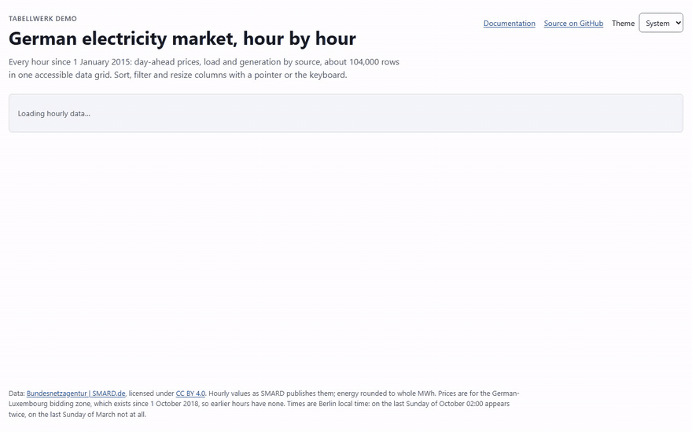
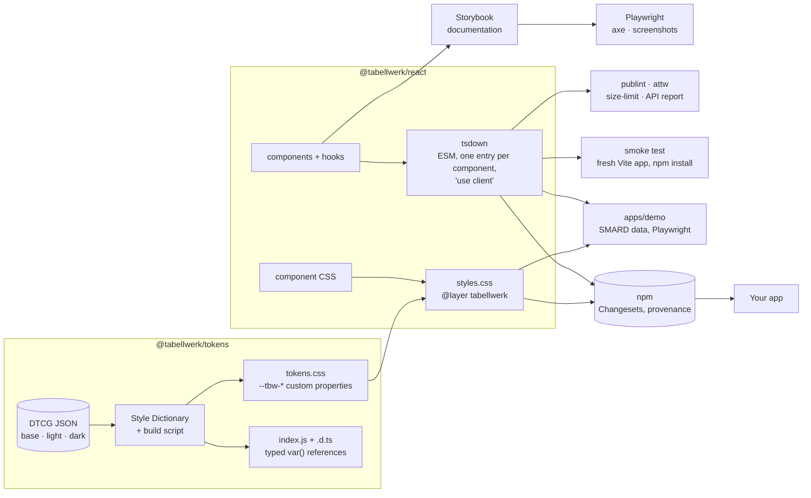
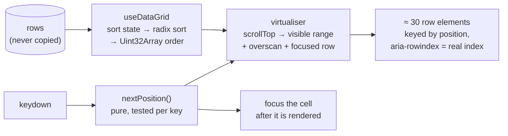

# Tabellwerk

**Accessible React components centred on a fast data grid.** A WAI-ARIA grid for 100,000 rows with
sorting, filtering and column resizing by keyboard and pointer, plus the two widgets most libraries
get wrong: a combobox with autocomplete and a date picker. Framework-neutral design tokens,
light/dark/forced-colours themes, and every claim backed by a test.

**Documentation:** [tabellwerk.vercel.app](https://tabellwerk.vercel.app) (Storybook: component docs,
keyboard tables, all stories in light and dark; try the
[100,000-row grid](https://tabellwerk.vercel.app/?path=/story/components-datagrid--hundred-thousand-rows))

**Demo:** [tabellwerk-demo.vercel.app](https://tabellwerk-demo.vercel.app) (every hour of the German
electricity market since 2015, 104,256 real rows)



> **Status:** all components and the demo are done (Phases 0 to 5 of the [roadmap](docs/ROADMAP.md)).
> The first npm release, 0.1.0, is prepared; until it is published, install from a clone.

## Demo

[`apps/demo`](apps/demo) shows the library with real data: **every hour of the German electricity
market since 1 January 2015**, 104,256 rows of day-ahead prices, load and generation by source from
[SMARD](https://www.smard.de) (Bundesnetzagentur | SMARD.de, CC BY 4.0). Two date pickers choose the
period, a combobox chooses the series (one column each), and the grid sorts, filters and resizes all
of it. The data is a recording committed with the app, so it works without any server of ours and
its tests need no network ([ADR 10](docs/adr/0010-demo-data-source.md)). Live at
[tabellwerk-demo.vercel.app](https://tabellwerk-demo.vercel.app).

## Packages

| Package              | What it contains                                                                                            |
| -------------------- | ----------------------------------------------------------------------------------------------------------- |
| `@tabellwerk/tokens` | Design tokens as CSS custom properties (light, dark, forced colours) and typed `var()` references; no React |
| `@tabellwerk/react`  | Components and hooks; one entry point per component; one stylesheet that includes the tokens                |

## Features

Available today:

- **`DataGrid`** following the [WAI-ARIA grid pattern](https://www.w3.org/WAI/ARIA/apg/patterns/grid/):
  - 100,000 rows with its own virtualiser; only the rows in view are in the DOM, every row keeps
    its real `aria-rowindex`
  - one tab stop; arrow keys, Home/End, Ctrl+Home/End, PageUp/PageDown; Enter or F2 into links and
    buttons inside cells, Escape back; the focused row stays mounted when scrolled away
  - stable single and multi-column sorting by click, Enter or Space, announced to screen readers;
    radix sort over an index permutation, `rows` is never copied
  - per-column filters (text, number range, values, date range) in a header dialog, applied while
    typing; the number of matching rows is announced
  - column resizing by dragging the header edge (mouse, pen, touch) or with the keyboard, and fit
    to content; a width change renders no row
  - controlled or uncontrolled sort, filter and width state, translatable texts, `useDataGrid()`
    for custom markup
- **`LiveAnnouncer`** with `useAnnouncer()`: polite and assertive screen reader announcements
- **`VisuallyHidden`**: text for assistive technology only

```tsx
import { DataGrid, type ColumnDef } from "@tabellwerk/react";
import "@tabellwerk/react/styles.css";

const columns: ColumnDef<Price>[] = [
  { id: "time", header: "Time", filter: "date" },
  { id: "price", header: "Price €/MWh", align: "end", filter: "number" },
];

<DataGrid aria-label="Day-ahead prices" rows={rows} columns={columns} style={{ height: 480 }} />;
```

- **`Combobox`** following the [WAI-ARIA combobox pattern](https://www.w3.org/WAI/ARIA/apg/patterns/combobox/):
  - focus stays in the field (`aria-activedescendant`); list and inline autocomplete; matching
    ignores case and diacritics ("zurich" finds "Zürich")
  - correct input method (IME) handling: no filtering while Japanese or Chinese text is composed
  - groups, 5,000-option lists rendered virtually with `aria-setsize`/`aria-posinset`, options
    from a server with loading, empty and error states and aborted stale requests
  - several values as removable chips; forms: `name`, `required` with native validation, reset
  - tested with real keys in Chromium, Firefox and WebKit; `useCombobox()` for custom markup

- **`DatePicker`** following the WAI-ARIA date picker dialog pattern:
  - values are ISO date strings (`"2026-11-23"`), never `Date` objects: no time zone or daylight
    saving change can shift a day
  - modal calendar dialog (`showModal()`): focus on the selected date or today, arrows by day and
    week, Page Up/Down by month, Shift by year, focus returns to the button
  - the locale sets input format, names and first day of the week; typed dates are read in the
    locale's order ("03/04" is 3 April in German, 4 March in US English)
  - `min`, `max` and unavailable days; forms with `name`, `required` and reset; `Calendar` and
    `useCalendar()` on their own
- The grid's filters use the library's own widgets: the combobox for values, the date picker for
  date ranges

Planned:

- The first npm release, 0.1.0 ([ADR 11](docs/adr/0011-releases.md))

## Tech stack

| Area           | Choice                                                                     |
| -------------- | -------------------------------------------------------------------------- |
| Monorepo       | pnpm workspaces, Turborepo                                                 |
| Library        | React 19, TypeScript 6 (strict, `isolatedDeclarations`), tsdown (ESM only) |
| Styling        | Plain CSS on custom properties, in the cascade layer `tabellwerk`          |
| Tokens         | DTCG JSON, Style Dictionary                                                |
| Documentation  | Storybook 10                                                               |
| Testing        | Vitest (Node and browser mode), Playwright, axe-core                       |
| Package checks | publint, Are the Types Wrong, size-limit, API Extractor                    |
| Releases       | Changesets                                                                 |

## Architecture



Inside the grid, data and rendering are separate:



The reasoning behind these choices is recorded in [Architecture Decision Records](docs/adr):
[package layout and toolchain](docs/adr/0001-monorepo-and-package-layout.md),
[tokens and cascade layers](docs/adr/0002-styling-with-tokens-and-cascade-layers.md),
[testing strategy](docs/adr/0003-testing-strategy.md),
[own virtualiser](docs/adr/0004-own-virtualiser.md),
[sorting with radix sort](docs/adr/0005-sorting-with-rank-permutations.md),
[focus and keyboard model](docs/adr/0006-grid-focus-and-keyboard-model.md),
[header controls, filtering and resizing](docs/adr/0007-header-controls-filtering-and-resizing.md),
[combobox](docs/adr/0008-combobox.md),
[date picker](docs/adr/0009-date-picker.md),
[demo data source](docs/adr/0010-demo-data-source.md),
[releases](docs/adr/0011-releases.md).

## Performance

Measured on the production Storybook build with 100,000 synthetic rows × 8 columns, Chromium
158 (headless), CPU throttled 4×, median of 5 runs, on 2026-11-18: locally on an Intel Core
i5-12400F and in CI on a GitHub-hosted `ubuntu-latest` runner (run on PR 6)
([method](docs/adr/0004-own-virtualiser.md#measurements)):

| Interaction                                                 |   Local |      CI | Budget in CI |
| ----------------------------------------------------------- | ------: | ------: | -----------: |
| Mount the grid (click → next paint)                         |  128 ms |   80 ms |       200 ms |
| Sort by a number column                                     |   72 ms |   80 ms |       200 ms |
| Sort by a text column                                       |   64 ms |   64 ms |       200 ms |
| Keyboard step (ArrowDown, PageDown)                         |   32 ms |   32 ms |       100 ms |
| Key press in a text filter (until the character is painted) |   24 ms |   16 ms |       100 ms |
| Key press in a text filter (until the filtered rows show)   |   74 ms |   68 ms |       200 ms |
| Long frames (> 50 ms) while jumping through 10,000 rows     |       2 |       0 |           20 |
| Worst frame while dragging a column edge 200 px             | < 50 ms | < 50 ms |       100 ms |

GitHub-hosted runners vary from run to run: on PR 4 the same runner type needed 112 ms to mount
the grid, on PR 6 80 ms. The budgets are set so that both pass with room to spare.

Interaction times come from the Event Timing API, the data INP is computed from; frames come from
the Long Animation Frames API, which reports only frames over 50 ms. CI runs the same measurement
on every pull request and fails when a median exceeds its budget.

Bundle sizes (minified and brotli-compressed, checked by size-limit on every pull request):
everything 14.2 kB; the grid 13.9 kB, including the combobox and date picker its filters use; the
combobox alone 4.7 kB; the date picker alone 4.2 kB; the stylesheet with all tokens 3.3 kB.

### Lighthouse (demo)

Measured on the deployed demo ([tabellwerk-demo.vercel.app](https://tabellwerk-demo.vercel.app),
production build of `4c854d6`) in Chrome DevTools in a private window, on 2026-11-25:

| Profile | Performance | Accessibility | Best Practices | SEO | First Contentful Paint | Largest Contentful Paint |
| ------- | ----------: | ------------: | -------------: | --: | ---------------------: | -----------------------: |
| Desktop |          88 |           100 |            100 | 100 |                  0.4 s |                    2.1 s |
| Mobile  |          86 |           100 |            100 | 100 |                  1.2 s |                    1.2 s |

The page loads 2.2 MB of data (Brotli) before the grid can show it
([ADR 10](docs/adr/0010-demo-data-source.md)); Largest Contentful Paint on desktop is the weakest
value. The Storybook documentation site has not been measured yet.

## Project structure

```
packages/
  tokens/     @tabellwerk/tokens: DTCG sources, build script, contrast tests
  react/      @tabellwerk/react: components, stories, tests, Storybook config
    e2e/      Playwright: axe and visual regression on the Storybook build
    etc/      API report (public API, reviewed in every pull request)
apps/
  demo/       Vite app with SMARD data; uses the built packages like an installed dependency
    scripts/  records the SMARD data into public/data
    e2e/      Playwright: behaviour and axe on the production build
scripts/      static file server, visual tests in Docker, smoke test, publishing, preview GIF
docs/
  adr/        Architecture Decision Records
  media/      the preview GIF (recorded by `pnpm --filter demo record:preview`)
  ROADMAP.md  phases and their "done when" criteria
```

## Getting started

Requirements: Node.js 24+, pnpm, and Docker for updating visual baselines.

```bash
pnpm install
pnpm --filter @tabellwerk/react exec playwright install chromium   # once
pnpm build
pnpm storybook        # http://localhost:6006
pnpm demo             # http://localhost:5173
```

## Scripts

| Command              | What it does                                                                        |
| -------------------- | ----------------------------------------------------------------------------------- |
| `pnpm check`         | Lint, typecheck, unit and browser tests, build, package checks (everything CI runs) |
| `pnpm storybook`     | Storybook in development mode                                                       |
| `pnpm build:docs`    | Static Storybook build in `packages/react/storybook-static`                         |
| `pnpm e2e`           | axe on every story in light, dark and forced colours (needs `build:docs`)           |
| `pnpm demo`          | Demo application in development mode                                                |
| `pnpm demo:e2e`      | End-to-end and axe tests on the demo's production build (needs `pnpm build`)        |
| `pnpm visual:update` | Record visual baselines in the Playwright Docker image                              |
| `pnpm perf`          | Performance measurements and budgets (needs `build:docs`)                           |
| `pnpm smoke`         | Install the packed packages into a fresh Vite app and check it (needs `pnpm build`) |
| `pnpm changeset`     | Describe a change for the changelog                                                 |
| `pnpm format`        | Format the codebase with Prettier                                                   |

## Deployment

The documentation site is the static Storybook build on Vercel (project `tabellwerk`; build
command `pnpm build:docs`, output `packages/react/storybook-static`). Every push to `main` deploys
to [tabellwerk.vercel.app](https://tabellwerk.vercel.app); pull requests get preview deployments.
The demo is a second Vercel project (`tabellwerk-demo`; build command
`pnpm turbo run build --filter=demo`, output `apps/demo/dist`), deployed the same way to
[tabellwerk-demo.vercel.app](https://tabellwerk-demo.vercel.app).

## Releases

Versions and changelogs come from [Changesets](https://github.com/changesets/changesets); both
packages always share one version. On every push to `main` the release workflow opens or updates a
"Version Packages" pull request. Merging it publishes the new versions to npm with provenance
through trusted publishing (no npm token), tags them, creates GitHub releases and runs the smoke
test against the published package ([ADR 11](docs/adr/0011-releases.md)). Nothing is published to
npm yet.

## Testing

Tests run where the code runs ([ADR 3](docs/adr/0003-testing-strategy.md)):

| Layer             | Tool                                            | What it covers                                                                 |
| ----------------- | ----------------------------------------------- | ------------------------------------------------------------------------------ |
| Tokens            | Vitest                                          | WCAG contrast of every colour pair in light and dark, build output             |
| Server rendering  | Vitest in Node                                  | Components render without a DOM; live regions exist before the first message   |
| Keyboard, pointer | Vitest browser mode (Chromium via Playwright)   | Real key events through the browser's input pipeline                           |
| Stories           | Storybook Vitest addon                          | Every story renders, its play function passes, axe finds no violation          |
| Accessibility     | Playwright + axe-core                           | WCAG 2.1 A/AA on every story (light, dark, forced colours) and docs page       |
| Visual regression | Playwright in Docker                            | Screenshot of every story in light and dark, compared pixel by pixel           |
| Package           | publint, attw, size-limit, API Extractor        | Exports, type resolution, size per entry point, unintended public API changes  |
| Smoke test        | npm, TypeScript, Vite, Playwright               | The packed packages in a fresh app outside the monorepo: types, build, widgets |
| Performance       | Playwright, Event Timing, Long Animation Frames | Interaction and scroll budgets on 100,000 rows; render counts per key press    |
| Demo              | Vitest, Playwright + axe-core                   | Data decoding incl. clock changes; the production build with recorded data     |

## What was hard

Things that took longer than expected so far, and what they changed.

- **Two axe runs in one page.** The accessibility tests failed about once in fifty runs with "Axe is
  already running": Storybook's a11y addon starts its own axe pass inside the story frame, and the
  Playwright test started a second one at the same moment. The tests now open stories with the
  addon in manual mode and wait for the story's play function to finish, which also made the
  screenshots deterministic. 140 repeated runs passed afterwards.
- **Screenshots that depend on the operating system.** Font rendering on Windows differs from the
  Linux CI runners, so baselines recorded on the development machine would fail in CI. Baselines are
  recorded and compared only in the Playwright Docker image; the local script copies the repository
  into the container without `node_modules`, because the Windows native binaries do not run there.
- **Sorting 100,000 rows within an interaction budget.** The first version sorted an index array
  with a comparison function and took 216 ms from click to paint (CPU throttled 4×), above the
  200 ms INP threshold. Two changes brought it to 72–80 ms: keying rows by position, so React updates
  the visible row elements instead of recreating them, and replacing the comparison sort with a
  stable radix sort over order-preserving 64-bit keys (IEEE 754 bits for numbers, ranks for
  strings). Reference tests compare the result with `Array#sort` on 10,000 to 30,000 random rows,
  including `-0`, infinities and empty values. ([ADR 5](docs/adr/0005-sorting-with-rank-permutations.md))
- **Real key presses and parallel test files.** Browser tests send keys through Playwright, which
  types into whichever frame has focus. Vitest runs test files in parallel frames of one browser,
  so key presses from one file landed in another and tests failed only when run together. Browser
  test files now run one after another.
- **Measuring on a laptop that sleeps.** A measurement run that overlapped with the machine going
  to sleep reported a five-hour test and nonsense frame times, and one run overlapped with another
  test run. Both were thrown away; the numbers above come from runs with nothing else running.
- **Real pointer input missed the resize handle.** Synthetic `PointerEvent`s cannot be used for
  drag tests, because `setPointerCapture()` needs a real active pointer. The tests send mouse and
  touch input from the Playwright side instead, and at first every drag did nothing: the test
  frame was 414 pixels wide by default, so the handle at x ≈ 710 was outside it and the press
  landed next to the frame. The browser tests now run at 1280 × 900.
- **"Fit to content" measured the cell, not the content.** The first version took the full text
  width plus "everything else in the cell", which for a wide column with short text is the cell
  itself: the column stayed 800 px wide. It now adds up the padding, the gaps and the widths of
  the flex children, using the scroll width for truncated text.
- **A popover that reopened itself.** With `popover="auto"`, a click on the filter button first
  closed the open dialog (light dismiss on pointer down) and then the click opened it again. The
  dialog uses `popover="manual"` and its own outside-press handling, which ignores its header.
  ([ADR 7](docs/adr/0007-header-controls-filtering-and-resizing.md))
- **One Escape key, two widgets.** The grid's filter dialog closes on Escape, and the combobox
  inside it closes its list on Escape. Both listen to the same key event, so one press would have
  closed the list and the dialog. Controls now mark keys they handle (`preventDefault`), the dialog
  ignores handled keys, and a test presses Escape twice and checks that only the second press
  closes the dialog. ([ADR 8](docs/adr/0008-combobox.md))
- **A loading flag that raced its request.** The first version set "loading" at the start of the
  effect that fetches server options, which React's lint rules reject (a synchronous state update
  in an effect causes an extra render) and which can show "loading" for a result that has already
  arrived. Loading is now derived: the last result remembers its query, and the list is loading
  while that query differs from the typed text. Late answers to older queries are ignored for the
  same reason.
- **Firefox found two problems the other engines did not.** The first CI run in Firefox and WebKit
  failed twice in Firefox. Tab from the combobox landed in the list, because Firefox makes a
  scrollable element without focusable children a tab stop; the list now has `tabindex="-1"`. The
  form reset test also failed, and a first fix based on a guess did not help. A trace in CI showed
  that the reset button was never clicked: the test before it submitted an empty required field,
  and Firefox's validation bubble, which is browser UI, swallowed the next click. The reset itself
  worked; the validation test now checks `checkValidity()` instead of clicking submit, and the
  guessed workaround was removed again.
- **Focus that landed on the wrong button.** The date picker's calendar is meant to open with
  focus on the selected date. The screenshot showed it on "Previous month": React runs a child's
  effects before its parent's, so the calendar focused its day before the parent had opened the
  `<dialog>`, and `showModal()` then focused the first button in it. The date picker now moves focus
  to the day right after `showModal()`, and a test checks the focused date after opening.
  ([ADR 9](docs/adr/0009-date-picker.md))
- **A grid that rendered all 104,256 rows.** The first demo build froze the tab. The grid was a
  `flex: 1` item in a column without a fixed height, where the flex basis falls back to the
  content: 3.7 million pixels of rows. The virtualiser measured that as its viewport and rendered
  every row. A paused debugger showed React creating DOM nodes; the grid now has a definite height,
  as its documentation asks, and the stylesheet comment says why.
- **Header widths guessed from character counts.** The demo first sized its columns as "characters
  × a constant". On the deployed site the headers were cut off as soon as a sort arrow appeared,
  because `system-ui` is a different font on every platform. Widths are now measured with the page
  font (canvas `measureText`) plus the header's padding, filter button and sort arrow, and an
  end-to-end test sorts a column with every series shown and fails if any header text overflows.
- **`format` was called with `null`.** A filter test crashed in `toFixed()`, because the grid
  passed empty values to the column's `format`. Empty values now always render as empty cells and
  `format` receives only non-empty values, which its type says.

## License

[MIT](LICENSE)
